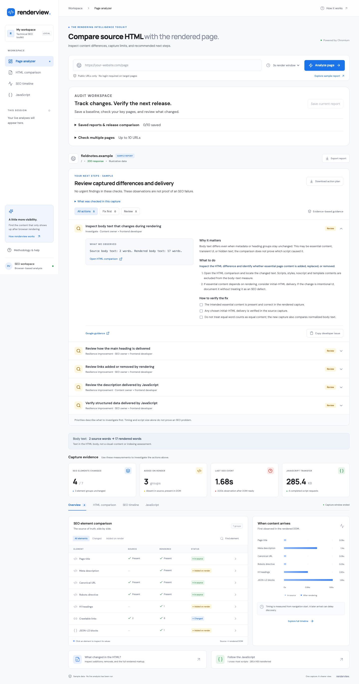

# renderview

**Compare source HTML with the rendered page.**

A technical SEO dashboard that compares response HTML with the DOM after JavaScript runs. Built with **React 19, Vite, TypeScript, Node.js, Playwright, and Chromium**, with a single-container Google Cloud Run deployment.



## What you can do

- Start with a prioritized action plan: observed problems and intent checks first, rendering improvements second.
- Get evidence, an owner, recommended steps, and acceptance criteria for every finding.
- Copy an individual developer issue or download the complete Markdown handoff. JSON exports include findings.

- Compare source and rendered title, meta description, canonical, robots, H1s, crawlable links, and JSON-LD blocks.
- Inspect additions and removals in a full HTML text diff, or download either capture.
- Follow SEO element arrivals, updates, and removals on a navigation-relative timeline.
- Inspect script loading initiators, transfer sizes, timings, response codes, and cross-host requests.
- Filter element groups, inspect literal values, switch between recent session reports, and export JSON.
- Explore a clearly marked sample before running an analysis.


## How the measurements work

1. Create a new Chromium browser and isolated context. Disable service workers; do not import cookies or login state.
2. Fetch the target through an outbound proxy that validates DNS answers and connects to the validated IP. Redirect and subresource destinations use the same policy.
3. Preserve the final main navigation response body as source HTML. Extract SEO values using Cheerio without executing it.
4. Install a MutationObserver before page scripts. Record literal SEO values when each group changes.
5. Wait for DOMContentLoaded and then the configured observation window. Capture the rendered DOM, compare groups, and collect Chromium network events.
6. Close Chromium and all proxy sockets. Return the report without saving target content on the server.

An **Added on render** group is absent from the source but present in the final DOM. A **changed** group has different values or ordering. This is a heuristic based on source/DOM differences, not proof of a particular script's effects. Browser HTML repair can also affect values. The script initiator graph records loading relationships; causal attribution would require separate script-blocking experiments, which this version does not perform.

## Turn evidence into action

The action plan appears before the capture metrics. “Fix first” includes captured HTTP errors, missing titles, conflicting or changing canonicals, malformed JSON-LD, and noindex directives that need an intent check. “Review” covers rendering-dependent metadata, headings and links, removed elements, and captured runtime exceptions.

Priorities do not predict rankings or indexing. Noindex may be intentional; the guidance explicitly asks the owner to confirm page intent. JavaScript delivery alone is not labeled a failure. Script size and arrival times do not trigger arbitrary severity thresholds. Missing optional descriptions or structured data do not automatically generate issues. JSON parsing checks syntax only, not schema eligibility. Relative canonical URLs are resolved against the final captured URL for comparison; HTML base tags are not modeled by this rule.

Every finding includes literal evidence, why it matters, an owner, recommended steps, and verification criteria. The complete-value inspector remains available where an element is implicated. Copy or download the handoff for a developer; no issue is automatically sent to an external service. Sample handoffs are clearly marked as illustrative. Capture warnings travel with the handoff and are shown above the action list.

The deterministic rules live in `shared/findings.ts`. They run on the client report and are included in downloaded JSON; the raw capture API response remains unchanged. Rules cover a limited set of checks, not a full SEO audit. A finding-free capture is not proof of indexability.

## Measurement limits

- This is a desktop Chromium diagnostic, **not a Googlebot emulator or a prediction of indexing**. It does not scroll, click consent banners, authenticate, or wait indefinitely.
- Timeline values use navigation-relative `performance.now()`. Parser insertion is observable too; “first observed” is not necessarily JavaScript insertion. A JS-triggered navigation is flagged because it can replace the document and reset the clock.
- Compare groups literally: arrays, order, whitespace, relative URLs, JSON formatting, and browser serialization matter. JSON-LD presence is measured; schema validity is not assessed.
- Script transfer is Chromium's encoded transfer size, including network overhead. Inline scripts, unfinished requests, and workers are not counted. “Cross-host” means different hostname, not different owner or registrable domain.
- No report persistence or account database. The last eight live reports stay in memory in the tab until refresh. Export JSON for a durable copy.
- HTML is decoded as UTF-8; legacy encodings can produce source-text discrepancies.
- Captures cap HTML at 3 MiB each, timeline at 500 events, browser errors at 30, proxy requests/connections at 300, aggregate proxy response/tunnel bytes at 40 MiB, and browser lifetime at about 40 seconds. Oversized or busy pages may be incomplete or fail. Resource pressure can still terminate a browser before these limits.

## Security and operations

Deploy this as an **authenticated internal tool**. The deployment script preserves Cloud Run IAM authentication. Use the authenticated local proxy in the setup guide to access it. The application does not implement public-user accounts, per-user quotas, or billing.

Only HTTP/HTTPS on ports 80/443 is accepted. Loopback, private, link-local, multicast, metadata, and other reserved address ranges are rejected, including mixed DNS answers and IPv4-mapped IPv6. The proxy pins each destination's resolved public IP to its outbound socket. Chromium's implicit loopback proxy bypass is disabled. HTTP credentials are rejected, popups are closed, and service workers are blocked.

These are application-level controls, not a hostile-browser security boundary. Playwright's default Chromium launch disables its browser sandbox; the non-root container and Cloud Run isolation do not replace a separate hardened browser service. Keep the runtime service account without project roles, avoid attaching a private VPC, and do not expose this as an anonymous arbitrary-URL scanner. For public multi-tenant use, add authenticated quotas, a separate isolated browser worker tier, and enforced network egress controls. See [Playwright's container security guidance](https://playwright.dev/docs/docker).

Target HTML is shown as escaped React text, never injected into the dashboard. Report bodies are not cached. Errors are logged in truncated form and may contain target URLs; avoid sensitive query strings. Saved JSON includes captured page content and should be treated accordingly.

## Project layout

```text
src/                  React dashboard, sample report, local fonts, styles
shared/types.ts       Shared report contract and element labels
server/analyze.ts     Chromium capture and mutation/network instrumentation
server/extract.ts     Static extraction and group comparison
server/security.ts    URL and destination validation
server/proxy.ts       DNS-pinned outbound proxy
server/app.ts         Express API, limits, production asset serving
scripts/deploy.sh     Private Cloud Run deployment
Dockerfile            Node + Chromium production image
tests/               Unit, integration, API, desktop/mobile tests
docs/                Cloud setup and verification notes
```

## GitHub setup

Create an empty repository called `renderview`, then run these commands from this directory, replacing the remote URL:

```bash
git init
git add .
git commit -m "Build renderview technical SEO analyzer"
git branch -M main
git remote add origin https://github.com/YOUR-USERNAME/renderview.git
git push -u origin main
```

Do not commit credentials, `.env` files, target-page reports, or `node_modules`. Choose and add a license before making the project open source.

## Capture confidence and body text

Reports include normalized body-text differences, including equal-word-count replacements. Scripts, styles, noscript, and template contents are excluded; CSS visibility is not evaluated. Body-text changes are review items, not proof that JavaScript caused a change.

Pending/failed requests, blocked traffic, limits, and post-load navigation produce a capture-verification action. Zero findings is labeled as a time-bounded observation, with check coverage and a 10-second rerun option. A 10-second capture still cannot guarantee completion. Pages with no qualifying href links receive an intent check rather than an automatic defect.

## Longer-capture comparison

On a live report with a window shorter than 10 seconds, choose **Run longer capture and compare**. The app retains the first result and opens a fresh browser visit with a 10-second window. A comparison appears above the action plan with body text and all seven SEO groups side by side. Body text uses full normalized-text SHA-256 fingerprints, so equal word counts do not imply equal content; previews are only excerpts.

The backend retains pending and failed script request URLs, initiators, elapsed time, response status, and failure messages. The comparison matches these URLs against the second visit: completed, pending, failed, or not observed. Exact URL matches describe observations across two visits, not the same network request completing. Scripts are not automatically classified as analytics or irrelevant.

The result distinguishes content changes, stable content with unresolved capture conditions, stable captured content, and differences in the initial response/destination. Different source HTML prevents attributing the changes to wait time alone. Older reports without full text fingerprints remain explicitly limited. Two fresh visits are not a controlled causal experiment, and stable content does not establish indexing or completeness.

A failed longer capture preserves the first report and offers retry. Comparisons remain with session history and JSON exports; Markdown action plans include the comparison and unfinished script evidence. If a report predates request-detail collection, run a new short capture first.

### Saved baselines and multi-page checks

The **Audit workspace** adds browser-local saved reports (up to 10), JSON import/export,
release finding comparisons, and sequential checks of up to 10 explicit URLs. Open a saved
report or import a prior JSON export, then choose a baseline to compare against the current
report. Findings are marked **New**, **Still present**, **No longer detected**, or **Needs
verification**. A disappearing finding is not a verified fix: different destinations/windows,
failed responses, capture warnings, and browser errors prevent the stronger disappearance label.

Batch checks continue after individual failures, support stopping, and flag repeated rendered
titles and descriptions across distinct successful destinations. The batch uses the displayed
report's capture window. Export batch results before leaving: batch results are session-only.
Saved reports use localStorage and may hit browser quota for large HTML captures; errors are
shown without removing existing reports. Clear browser data only after exporting backups.
Import individual report JSON files; batch and comparison exports are summaries, not report imports.

See [feature comparison](docs/FEATURE_COMPARISON.md) for the upstream comparison and remaining gaps.
